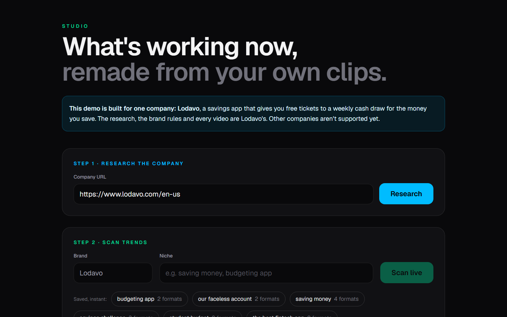

# HypeCreate

**Find the short videos working in your niche right now, then turn them into ready-to-post ads for your brand.**

**[Try the live demo → hypecreate.vercel.app](https://hypecreate.vercel.app)**

🥇 Our team won **1st place in the Compound Viral Award** at the [Hack the Feed hackathon](https://luma.com/92iq2a12)

Consumer apps grow on TikTok and Instagram through small UGC accounts: someone films themselves, posts every day, and the account warms up. When that person leaves, the account goes quiet. HypeCreate keeps it posting. It reads what is working for other creators this month, explains *why* each video works, and remakes that format as a new video for your brand, checked against your brand's rules.

## How it works

1. **Research the company.** Paste the company's website and the Studio shows a brand profile: what the product does, who it's for, and the guardrails every script must follow (what it may never claim, which legal line has to appear). For now the profile is pre-built for Lodavo (`app/studio/brand-profile.ts`, from `lodavo-brand-brief.md`), so any lodavo.com address works and other sites don't yet.
2. **Scan a niche.** Type a niche like "saving money" or "student budget". HypeCreate searches recent TikTok and Instagram videos from creators with 5k–200k followers through [Oriane](https://oriane.xyz), drops paid ads and off-topic videos, and ranks what's left by views per follower, so small accounts that punch above their weight rise to the top.
3. **Get the winning formats.** An AI model watches the top videos (transcript, on-screen text, opening frames) and groups them into formats: the hook pattern, the beat-by-beat structure, why it works, and links to the real videos as evidence.
4. **Make a video.** Pick a format and the Studio writes a script for your brand in that shape, generates the video on [GMI Cloud](https://gmicloud.ai) (Veo, Kling, Seedance, MiniMax), and burns in the legal line.
5. **Check the hook.** Open the video in the **brain view**, a 3D brain that lights up with the image and sound features of each moment, so you can see whether the first seconds grab attention. It measures the video in your browser. It is not a brain scan and does not predict views.

## Pages

| Page | What it's for |
|---|---|
| `/studio` | The whole flow above: research, scan, formats with evidence, make a video, and every video made so far |
| `/brain` | The brain view on its own. `/brain?video=/demo/strict-budget-store-run-veo.mp4` opens with that video |
| `/queue` | The planned posts for each account, with captions and time slots (read-only) |

## Deploying

It's a standard Next.js app, so it deploys to Vercel as-is. Leave `HYPECREATE_LIVE` unset and add no keys; the demo videos are served from `public/demo/`.

## Code map

| Where | What |
|---|---|
| `app/studio/` | The Studio page: research, scan progress, format cards, recent videos |
| `app/api/signal/` | Niche search → winning formats. `lib/oriane.ts` talks to Oriane, `analyze.ts` has the AI read the videos, `signal.ts` caches both layers in `data/` |
| `app/studio/generate/pipeline.ts` | Format + brand rules → script → GMI video → legal line (AI video) |
| `lib/create.ts`, `lib/render.ts` | Format → video cut from your own footage with ffmpeg (needs the local `clips/` library) |
| `lib/demo.ts` | Demo mode, and `data/demo-videos.json` lists the demo videos |
| `brand/lodavo.md` | Lodavo's brand rules: what scripts may say, what they never say, the legal line |
| `public/brain/` | The WebGL brain view |
| `lib/contract.ts` | The types shared between scan, create and brain |

## Bulk tools (live mode, on a machine with footage)

- `node scripts/batch.mjs clips/batches/<account>.json <person|faceless>` renders a batch of videos, each with a caption file.
- `node --env-file=.env.local scripts/results-loop.mjs clips/results/<account>.json <followers>` turns an account's own results into formats in the Studio.

## Credits

Built at the Hack the Feed hackathon by Avi Shah & Ben Thomas

## 🥇 Award

Our team won **1st place in the Compound Viral Award** at the [Hack the Feed hackathon](https://luma.com/92iq2a12)
